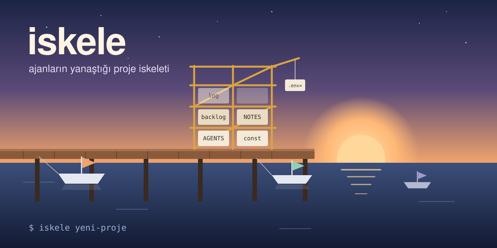

# iskele

<p align="center"></p>

Ajanlarla (Claude Code, Codex ve diğerleri) çalışacağın yeni bir kod projesini tek komutla kurar.
Ajanın ilk günden neyi nereye yazacağını bilir. Durum, geçmiş, fikir ve kararlar ayrı dosyalarda
tutulur, iş yarıda kalırsa kaybolmaz.

## Kurulum: tek prompt

Ajanına şunu söyle:

```
https://github.com/eneshasil/iskele reposundaki KURULUM.md dosyasını oku ve uygula.
```

Ajan repoyu `~/.iskele` klasörüne indirir, skill'i bağlar ve `iskele` komutunu kurar.
Elle kurmak istersen:

```bash
git clone https://github.com/eneshasil/iskele ~/.iskele && bash ~/.iskele/install.sh
```

Güncellemek için `git -C ~/.iskele pull`. Kaldırmak için `bash ~/.iskele/install.sh --uninstall`.

## Kullanım

Ajanına "iskele ile yeni proje aç: hava-durumu" de. Ya da terminalde:

```bash
iskele hava-durumu              # bulunduğun klasörde, private GitHub reposuyla
iskele hava-durumu --public     # public repo
iskele hava-durumu --no-github  # yalnız yerel git
iskele hava-durumu --dir ~/kod  # başka bir klasörde
```

GitHub adımı için [`gh`](https://cli.github.com) kurulu ve `gh auth login` yapılmış olmalı.

## Ne kurar?

| Dosya | Ne işe yarar |
|---|---|
| `AGENTS.md` | Ajan talimatlarının tek kaynağı. Oturum başı okuma listesi, çalışma ve alt agent kuralları. |
| `CLAUDE.md` | Yalnız `@AGENTS.md` içerir; iki dosya birbirinden sapamaz. |
| `const.md` | Projenin değişmez gerçekleri. Ajan senin onayın olmadan değiştirmez. |
| `backlog.md` | Açık ve yarıda kalan işler. Ajan işe başlarken önce buraya yazar. |
| `backlog-log.md` | Olanların kaydı. Yalnız sona eklenir, eski satırlar değişmez. |
| `reports/` | Araştırma ve keşif raporları. Alt agent bulgusunu buraya yazar, şefe yalnız özet döner. |
| `NOTES.md` | Fikirleşme: ham dump `Taslak`'a, onayladıkların `Kesinleşmiş`'e. |
| `DECISIONS.md` | "X yerine neden Y" kararları: tarih, alternatif, gerekçe. |
| `.gitignore`, `.env`, `.env.example` | `.env` ilk commit'ten önce dışarıda bırakılır; sır geçmişe hiç girmez. |

## Alt agent kuralları

Üretilen `AGENTS.md`'de ajanın alt agent'larla nasıl çalışacağı yazılı:

- **Şef işçilik yapmaz.** Bağımsız parçalar ve büyük okumalar alt agent'lara gider; küçük ya da sıralı iş gitmez.
- **Brief** hedefi, dokunulabilecek ve dokunulmayacak dosyaları, teslim biçimini söyler; "nasıl"ı serbest bırakır.
- **Sahiplik:** aynı dosyaya iki agent gitmez. Büyük paralel işte her agent kendi worktree'sinde çalışır.
- **Commit:** alt agent yalnız kendi branch'ine commit atar. Ortak klasörde `reset`, `checkout`, `stash` yapmaz.
- **Kayıt:** bulgular `backlog-log.md`'ye eklenir, `backlog.md`'yi yalnız şef günceller.
- **Rapor:** keşif bulguları `reports/` altında dosyaya yazılır; şefin bağlamı dolmaz, sonraki oturum aynı keşfi tekrarlamaz.
- **Doğrulama:** kritik işi ayrı bir denetçi kontrol eder. Düzeltme geri alınınca kırılmayan test sahtedir.
- **Tekrarlayan sorun kurala dönüşür.**

Kuralları kendine göre değiştir: üretilen proje senin, `AGENTS.md` de.

## Gereksinim

`bash` ve `git` (macOS, Linux ya da Windows'ta WSL). GitHub için `gh` isteğe bağlı.

## Lisans

MIT
